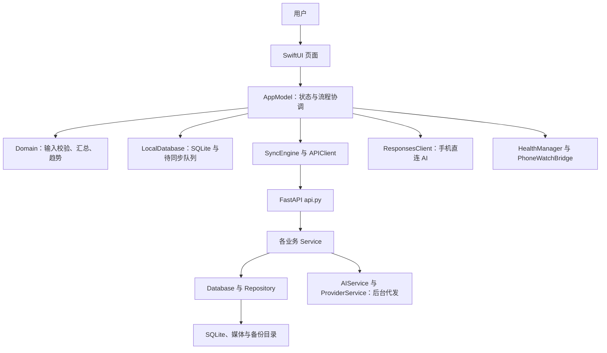

# 代码导读

本文用于未参与开发的 AI 或开发者接手。以 0.1.10 客户端、0.1.9 后台的现有结构为基础；本次整理不改变功能。先读 [根目录入口](../AGENTS.md)，业务细节见 [数据契约](业务规则与数据契约.md)，命令见 [开发指南](开发与验证指南.md)。

## 一、系统如何分工

客户端离线即可记录，后台用于同步、伙伴与可选 AI 代发。AI 调用有本机识别、手机直连、后台代发三条路径，不要将它们误当成同一个网络请求。项目没有运行在浏览器里的网页前端；所谓网页测试包是上传到模拟平台的 iOS 模拟器应用。

## 二、目录和职责

以下路径相对仓库根目录。

| 位置 | 职责与阅读重点 |
| --- | --- |
| `ios/BingJian/App/BingJianApp.swift` | App 启动、首次引导分流、五页导航、自定义底栏；`PersistentTabController` 缓存原有页面并转发生命周期 |
| `ios/BingJian/App/AppModel.swift` | 主线程可观察状态、存储和同步编排、账号切换、AI 配置、健康与 Watch 协调；用中文 `MARK` 定位分区 |
| `ios/BingJian/Views/` | 页面、录入表单、图表、统一设计组件；`DesignSystem.swift` 定义通用样式 |
| `ios/BingJian/Models/Records.swift` | 统一记录封套及档案、体重、食物、餐次等模型 |
| `ios/BingJian/Models/JSONValue.swift` | JSON 值、蛇形字段编解码、日期与业务日工具 |
| `ios/BingJian/Domain/` | 输入校验、重量换算、记录索引、能量与趋势计算；尽量先从此处理解计算规则 |
| `ios/BingJian/Data/` | 本地 SQLite、钥匙串、加密导出导入；数据按 namespace 分目录 |
| `ios/BingJian/Networking/` | 服务器地址与身份、会话和错误映射、HTTP、增量同步与快照恢复 |
| `ios/BingJian/AI/` | AI 设置、Responses 请求、结构解析、营养补全、本机 Vision 识别 |
| `ios/BingJian/Health/` | HealthKit 权限、查询、增量变化与授权错误说明 |
| `ios/BingJian/Platform/` | 相机、图片处理、提醒、后台任务、服务器发现、手机与 Watch 通信 |
| `ios/BingJianWatch/` | Watch 页面、状态及传输队列；部分模型和重量换算源码由 Xcode 工程共享 |
| `ios/BingJianTests/` | 领域、输入、AI、凭据、健康授权、生命周期和原生截图测试 |
| `ios/BingJianUITests/` | 首次设置到真实点击的完整流程，含相册、五页末尾和菜单复选 |
| `backend/app/main.py` | 创建 FastAPI 应用、生命周期、限流及统一异常响应 |
| `backend/app/runtime.py` | 组装数据库及各服务，管理单实例锁；是后台依赖关系的入口 |
| `backend/app/api.py`、`models.py` | HTTP 路由与请求/领域模型；路由转交服务 |
| `backend/app/auth.py`、`security.py` | 注册登录、会话、设备及安全基础能力 |
| `backend/app/records.py`、`domain.py` | 同步、快照、记录规则及后台能量计算；与客户端保持业务一致 |
| `backend/app/database.py`、`migrations/` | SQL 封装、事务和迁移；实体多使用 JSON payload，不是一种记录一张表 |
| `backend/app/ai.py`、`providers.py`、`foods.py` | AI 任务、营养解析、配置和密钥保存、外部目标校验及营养库 |
| `backend/app/challenges.py`、`push.py` | 伙伴/多人挑战、共享许可、积分、鼓励与推送 |
| `backend/app/media.py` | 媒体归属、上传、分块恢复与读取 |
| `backend/app/data_service.py`、`archive.py` | 个人导出导入、删除任务及加密归档 |
| `backend/app/maintenance.py`、`deletion_journal.py` | 系统备份恢复、删除账本与防止已删除数据被恢复 |
| `backend/app/jobs.py`、`cli.py` | 后台任务调度与运维命令 |
| `backend/app/resources/food_schema.json` | 客户端和后台共用的 AI 输出结构；Xcode 将此文件打进应用 |
| `backend/tests/` | 纯领域、HTTP API、真实进程启动与重启回归 |
| `tools/` | Xcode 工程生成、签名前准备、授权检查及 Docker/NAS 验收脚本 |
| `compose.yaml`、`Caddyfile` | 仓库根目录的本地构建与 HTTPS 反向代理 |
| `deploy/synology/` | 群晖拉取镜像部署，提供局域网 HTTP 与可选 HTTPS |
| `.github/workflows/` | 后台检查、镜像发布、iOS 可选打包及 iOS 17.5 专项验收 |
| `docs/` | 操作说明、业务契约、验收记录与历史变更说明 |

## 三、常用调用链

### 启动与本地记录

`BingJianApp → RootView → AppModel.start()`：加载当前本地身份和记录，决定进入引导还是主页面。`MainTabs` 只负责导航，不计算业务汇总。

`录入页面 → AppModel.saveRecord() → LocalDatabase.save() → AppModel.reload()`：数据库事务保存记录和 outbox，随后重建 `RecordIndex`、计算汇总、更新界面，并安排可选同步。首次引导中的档案和初始体重使用批量事务，避免只保存一半。

`AppModel.reload()` 与汇总刷新带结果标识校验，耗时计算放到后台任务；不要把计算重新塞回页面 `body`，也不要去掉过时结果检查。

### 后台同步

`AppModel.sync() → SyncEngine.synchronize() → APIClient → /api/v1/sync/* → RecordService → Repository`。

顺序是握手和身份检查、发送待执行命令、必要时恢复快照、上传允许同步的照片、逐批推送记录、分页拉取变化。同步回执区分成功、幂等重复、冲突和失败；不是“请求返回 200 就删除整个待发队列”。

### 餐食 AI

`MealEditorView → AppModel.recognize()` 根据模式分流：本机识别走 `OnDeviceRecognizer`；手机直连走 `ResponsesClient`；后台代发先同步必要的记录/照片，再提交 `/api/v1/ai/food-recognition` 并查询任务。

直连解析在 `FoodRecognition`，后台解析在 `AIService`。两条远程路径都要求食物重量、热量和三大营养素；不完整时自动补全一次。候选结果需要用户确认，模型列表可读不等于图像能力验证通过。

### 趋势与伙伴

`TrendsView → TrendCalculator → RecordIndex/EnergyCalculator → TrendSummaryChart/WeightTrendMarks`。实际体重点与移动平均是两个序列，不能互相替代。

`CommunityView → AppModel/APIClient → ChallengeService`。伙伴共享按成员和授权范围控制，显示体重时再按观看者的本机单位换算。

## 四、遇到需求应先改哪里

| 需求或问题 | 优先阅读 | 相关测试 |
| --- | --- | --- |
| 菜单重复、页面返回丢状态 | `App/BingJianApp.swift` | `AppearanceTests.swift`、`RecordingFlowUITests.swift` |
| 体重录入、日期、斤公斤 | `Views/BodyEditors.swift`、`Domain/WeightUnit.swift`、`Domain/RecordDate.swift` | `WeightUnitTests.swift`、`RecordingFlowTests.swift` |
| 趋势缺点、均线、摄入图 | `Domain/TrendCalculator.swift`、`Views/TrendSummaryChart.swift`、`Views/TrendsView.swift` | `AppearanceTests.swift`、`EnergyCalculatorTests.swift` |
| 每日能量差额 | 客户端 `Domain/EnergyCalculator.swift`、后台 `domain.py` | `EnergyCalculatorTests.swift`、`backend/tests/test_domain.py` |
| AI 只给名字、没有营养 | `AI/FoodRecognition.swift`、`AI/ResponsesClient.swift`、后台 `ai.py`、共享 Schema | `FoodRecognitionTests.swift`、`backend/tests/test_api.py` |
| 改模型要求重填密钥 | `AppModel` 的 AI 分区、`AIConnectionEditorView.swift`、后台 `providers.py` | `AICredentialReuseTests.swift` |
| 登录校验与错误提示 | `Domain/AccountInput.swift`、`AccountFieldsView.swift`、`APIErrorResponse.swift`、后台 `auth.py` | `AccountValidationTests.swift`、`ConfigurationAndValidationTests.swift` |
| 同步失败、数据冲突 | `Networking/SyncEngine.swift`、`Data/LocalDatabase.swift`、后台 `records.py` | `backend/tests/test_api.py`、`test_runtime.py` |
| 健康授权或个人重签 | `Health/`、各 entitlements、`tools/check_ios_health_entitlements.py` | `HealthAccessTests.swift`，并补真实设备验证 |

表中的客户端短路径均在 `ios/BingJian/` 下，客户端测试在 `ios/BingJianTests/` 下。定位用类型/方法名，不依赖容易过期的行号。
